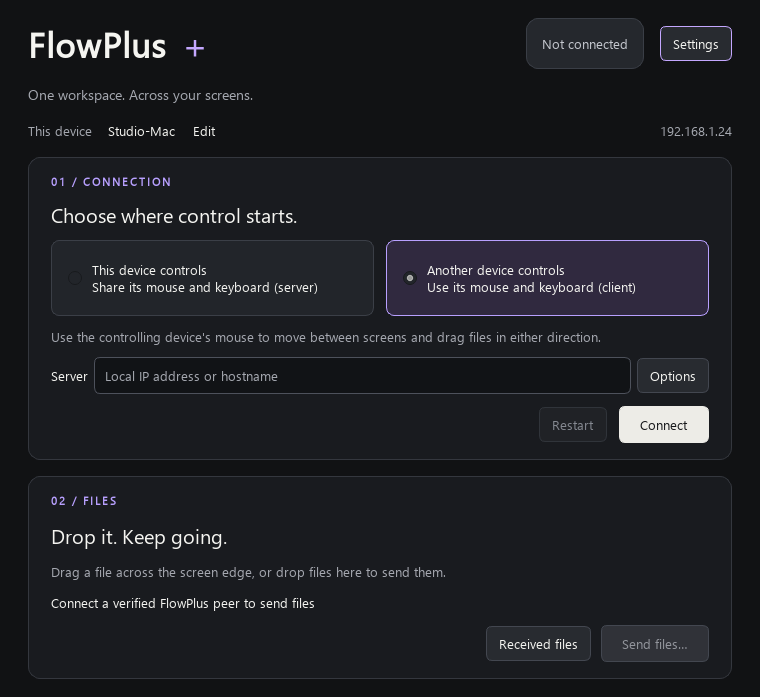

<p align="center">
  
</p>

<h1 align="center">FlowPlus</h1>
<p align="center"><strong>One mouse. One keyboard. Files across your screens.</strong></p>
<p align="center">An open-source software KVM for Windows, macOS and Linux, with experimental cross-device drag-and-drop file transfer.</p>

<p align="center">
  <a href="https://github.com/Kibra2025/FlowPlus/actions/workflows/continuous-integration.yml"></a>
  <a href="https://github.com/Kibra2025/FlowPlus/actions/workflows/transfer-tests.yml"></a>
  <a href="https://github.com/Kibra2025/FlowPlus/releases/tag/continuous"></a>
  <a href="docs/LICENSING.md"></a>
</p>

<p align="center">
  <a href="#download">Download</a> · <a href="#get-started">Get started</a> · <a href="#what-flowplus-adds-to-deskflow">Why FlowPlus?</a> · <a href="docs/TESTING.md">Testing</a> · <a href=".github/CONTRIBUTING.md">Contribute</a>
</p>

FlowPlus shares your **keyboard, mouse and clipboard between computers**. Move the pointer across a configured screen edge to control another machine. Its file sharing workflow aims to make copying a file just as natural: drag it across that edge and release to send it.

Built from [Deskflow](https://github.com/deskflow/deskflow), with a native C++/Qt file transfer service inspired by the [LocalSend protocol](https://github.com/localsend/protocol). No account or hosted relay is required. Software KVM means input sharing; FlowPlus does not stream video or mirror your displays.

> [!IMPORTANT]
> **Development preview.** Cross-device file dragging and destination recognition are experimental, with Windows ↔ macOS as the primary target. Automated CI does not replace testing with real devices. Read the [known limits](#known-limits) before relying on transfers.


*Interface preview rendered from the application's Qt UI, with example device details. This is not a live transfer screenshot.*

## What FlowPlus adds to Deskflow

Deskflow provides the keyboard, mouse, clipboard and input-networking foundation. FlowPlus builds on that work with a focus on moving files between the computers you already control.

| Area | Inherited foundation | FlowPlus additions |
| --- | --- | --- |
| Input sharing | Deskflow's software KVM and clipboard sharing | Integrated connection and file controls in one window |
| File workflow | Connected computers and configured screen edges | Experimental drag across screens, release to transfer, plus a **Send files** action |
| File delivery | Native platform integration | Recognition of supported Finder/Explorer folders and desktops, with a Downloads fallback |
| Transfer transport | TLS input connection and peer fingerprints | LocalSend-inspired negotiation and streaming, plus an acknowledged TLS fallback when direct preparation cannot connect |
| Interface and setup | C++/Qt application and platform backends | Dark interface with purple accents, clearer connection roles and a macOS Accessibility setup window |
| Application identity | Upstream source and history | FlowPlus executables, icons, settings, Windows service and packages |

**Why choose FlowPlus?** If your workflow involves a Windows PC and a Mac and you want input sharing and file delivery in the same app, this is the workflow FlowPlus is developing. If you only need keyboard and mouse sharing, [Deskflow](https://github.com/deskflow/deskflow) remains the upstream project to consider. There are no comparative performance or reliability claims here; the added file workflow still needs real-device testing.

## Download

Use matching FlowPlus builds on both computers. The **continuous** release is a moving development build, not a stable release.

| Device | Installer |
| --- | --- |
| Windows PC, Intel/AMD 64-bit | [Windows x64 MSI](https://github.com/Kibra2025/FlowPlus/releases/download/continuous/flowplus-continuous-win-x64.msi) |
| Windows on ARM | [Windows ARM64 MSI](https://github.com/Kibra2025/FlowPlus/releases/download/continuous/flowplus-continuous-win-arm64.msi) |
| Mac with Apple Silicon, including M-series chips | [macOS ARM64 DMG](https://github.com/Kibra2025/FlowPlus/releases/download/continuous/flowplus-continuous-macos-arm64.dmg) |
| Intel Mac | [macOS x86_64 DMG](https://github.com/Kibra2025/FlowPlus/releases/download/continuous/flowplus-continuous-macos-x86_64.dmg) |
| Linux | [DEB, RPM, Arch and Flatpak packages](https://github.com/Kibra2025/FlowPlus/releases/tag/continuous) |

[All release assets and portable Windows builds](https://github.com/Kibra2025/FlowPlus/releases/tag/continuous) · [SHA-256 checksums](https://github.com/Kibra2025/FlowPlus/releases/download/continuous/sums.txt)

Download FlowPlus from this repository. Upstream Deskflow packages and Homebrew/Flathub listings are separate products.

## Get started

1. Install FlowPlus on both computers and connect them to the same **trusted local network**.
2. On the computer whose physical mouse and keyboard you will use, select **This device controls** (server). Use **Arrange screens** to match the devices' positions and names.
3. On the other computer, select **Another device controls** (client), enter the controlling computer's local IP address or hostname, and connect. Keep TLS and peer fingerprint checking enabled and verify the peer certificates.
4. Check that the shared pointer crosses between screens normally. Use that controlling computer's mouse for file dragging in either direction.
5. Try **Send files** with a small regular file first; the receiver must accept the manual transfer. Then try dragging a file from Explorer/Finder across a configured screen edge. Release over the receiving screen to request delivery.

Recognized filesystem destinations receive the files without overwriting existing names. Unsupported or unwritable drop targets fall back to `Downloads/FlowPlus`. **Received files** opens the last delivery folder. After successful placement, unchanged temporary download copies are removed; originals on the sender remain intact. File receipt does not replace your clipboard.

### macOS permissions and first launch

Drag **FlowPlus.app** from the DMG into **Applications** and launch that installed copy. Current development builds are ad-hoc signed and **not notarized by Apple**. If Gatekeeper says Apple cannot verify the app, follow [Apple's instructions](https://support.apple.com/102445) for opening a trusted app through **System Settings → Privacy & Security → Open Anyway**.

Enable FlowPlus under **Privacy & Security → Accessibility**. The setup window waits for authorization. If it remains blocked after an update or re-signing, quit FlowPlus, remove its old Accessibility entry, add `/Applications/FlowPlus.app` again, enable it and relaunch. Grant the bundled `flowplus-core` process access if macOS requests it, and allow Local Network access when prompted. See [testing and troubleshooting](docs/TESTING.md).

## Network and transfer security

FlowPlus is intended for your own computers on a trusted LAN. **A strict LAN-only restriction is not yet enforced**: reachable remote addresses or VPN routes can still be used. There is no automatic NAT traversal or hosted relay. Do not expose the services directly to the public Internet.

| Purpose | Default port |
| --- | --- |
| Input sharing and transfer fallback | TCP `24800` |
| LocalSend-style discovery | UDP multicast `224.0.0.167:53317` |
| Direct file transfer | TCP `53317` |

File sharing requires connected, TLS-enabled FlowPlus peers with the transfer capability negotiated. **The direct HTTP file path is plaintext in this implementation**; the fallback uses the verified TLS connection. Use a trusted network, or an encrypted VPN where appropriate. A rejected transfer is never retried through the fallback. Discovery names are not proof of identity. See the [security policy](docs/Security.md).

## Known limits

- **Files only:** no folders or recursive directory transfers; up to 128 files and 64 GiB total per transfer. Names must be portable basenames of at most 255 UTF-8 bytes.
- **Drop targets:** Finder/Explorer must expose a recognizable filesystem folder, folder icon or desktop. Virtual folders, ambiguous targets and arbitrary application drops use Downloads. Exact desktop icon positioning is not supported.
- **Platforms:** Windows ↔ macOS is the file dragging target. Linux/BSD input support is inherited; equivalent native drop destination support is not implemented there.
- **Native dragging:** behavior depends on OS permissions, scaling, file managers and display configuration. See the [two-device checklist](docs/TESTING.md) and [validation record](docs/VALIDATION.md).
- **LocalSend compatibility:** partial. Standalone LocalSend offers are rejected unless authorized by the FlowPlus workflow; HTTPS LocalSend uploads are not implemented or silently downgraded. The LocalSend app is not bundled or required.
- **Release signing:** macOS Developer ID signing/notarization and reliable permission continuity across development updates remain open work.

## Build and contribute

FlowPlus uses **C++20, Qt 6.7+, CMake 3.24+ and OpenSSL 3+**. Platform dependencies, compilers and installer tools are covered in the [build guide](docs/dev/build.md).

```sh
git clone https://github.com/Kibra2025/FlowPlus.git
cd FlowPlus
# Install platform dependencies and make Qt discoverable first.
cmake -S . -B build -DCMAKE_BUILD_TYPE=Release
cmake --build build --config Release --parallel 4
ctest --test-dir build/src/unittests -C Release --output-on-failure
```

| Directory | Purpose |
| --- | --- |
| `src/` | Application, input backends, transfer service and tests |
| `cmake/`, `deploy/` | Build configuration and platform packages |
| `translations/` | Qt translation catalogs |
| `docs/` | Architecture, setup, testing and protocol references |
| `LICENSES/` | Preserved file-level licenses and exceptions |

Builds produce `flowplus`, `flowplus-core` and, on Windows, `flowplus-daemon` (`.exe` suffix on Windows; `FlowPlus.app` on macOS). Historical internal `deskflow` namespaces, resource paths and target names are retained where useful for compatibility and upstream maintenance.

Start with [architecture](docs/ARCHITECTURE.md), [contributing](.github/CONTRIBUTING.md) and [testing](docs/TESTING.md). Useful contributions include reproducible Mac ↔ Windows drag reports, macOS permission fixes, LAN-only enforcement, destination handling and translations. Report FlowPlus-specific issues [here](https://github.com/Kibra2025/FlowPlus/issues), with the build commit and both operating systems.

## Credits and license

FlowPlus is an independently maintained derivative of **[Deskflow](https://github.com/deskflow/deskflow)**. Its source history, input-sharing architecture and original contributors' notices are preserved. **[LocalSend](https://github.com/localsend/localsend)** and its [protocol](https://github.com/localsend/protocol) inspired the file transfer service; no nested LocalSend checkout or Flutter/Dart/Rust runtime is needed. FlowPlus is not an official release of either project.

The application retains **GPL-2.0-only with the OpenSSL exception** where specified. Build files, documentation and third-party assets retain their own MIT/LGPL and other file-level terms. The LocalSend Apache 2.0 reference notice does not relicense FlowPlus.

Read [LICENSE](LICENSE), the [license guide](docs/LICENSING.md), [NOTICE](NOTICE.md), [third-party notices](THIRD_PARTY_NOTICES.md) and [LICENSES](LICENSES).
