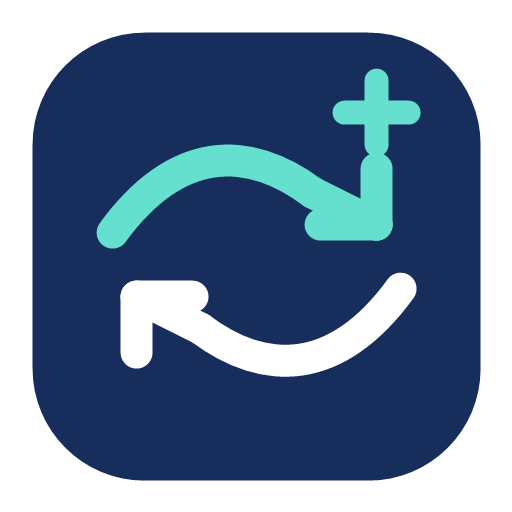

# FlowPlus

FlowPlus shares a keyboard, mouse and clipboard between computers. It is a fork of [Deskflow](https://github.com/deskflow/deskflow) with an experimental file transfer workflow inspired by [LocalSend](https://github.com/localsend/localsend).

The goal is simple: drag files from one computer, move the pointer to another connected screen, and release the button to start transferring them. Windows ↔ macOS is the primary file transfer target. The inherited input sharing also includes Linux support.

**Development status:** file dragging is experimental. Automated checks do not establish that operating system drag capture works on real Windows/macOS pairs. See the [manual test checklist](docs/TESTING.md) before relying on it.

## How file transfer works

1. Connect both computers to FlowPlus, configure their screen positions, enable TLS and peer fingerprint checking, and verify the peer certificates.
2. Drag regular files from a file manager toward the edge that leads to the receiving screen. FlowPlus stages the selected files and sends their metadata to that connected peer.
3. When the pointer reaches the receiving screen, an overlay shows the pending drop. Releasing the left mouse button requests the transfer.
4. Files arrive in the receiver's `Downloads/FlowPlus` folder. After a gesture drop, the application puts the received file URLs on the clipboard. Manual transfers require a receiver prompt and leave the clipboard unchanged.

The native Qt service implements LocalSend v2 REST negotiation and streaming. It does not require Flutter, Dart, Rust, a running LocalSend app, or a nested LocalSend checkout. If direct transfer preparation cannot reach the peer, FlowPlus can use the established TLS input connection for a bounded, acknowledged file stream. A rejected transfer is not retried through the tunnel.

## Across the Internet

Use a VPN or another network setup that makes the FlowPlus input connection reachable. The default input port is **TCP 24800**. LocalSend discovery uses **UDP multicast 224.0.0.167:53317** and normally stays within a local network; direct HTTP file transfer uses **TCP 53317**. A VPN need not forward multicast when the already connected FlowPlus peers are used.

FlowPlus does not provide a hosted relay, account service, automatic NAT traversal, or remote device discovery. Its HTTP LocalSend path is not encrypted by this implementation; use it on a trusted LAN or encrypted VPN. The fallback uses the verified FlowPlus TLS connection. File sharing requires TLS-enabled, connected FlowPlus peers that have negotiated the transfer capability; upstream Deskflow peers remain available for input sharing.

## Current limits

- Regular files only: folders and recursive directory transfers are not supported.
- Up to 128 files and 64 GiB total per transfer; incoming names must be portable basenames of at most 255 UTF-8 bytes.
- Received files are saved without replacing existing files. Interrupted partial files are not published as completed downloads.
- On macOS, the reliable delivery destination is `Downloads/FlowPlus`, with clipboard access after gesture drops. A native Finder drop is not implemented.
- Windows desktop delivery and optional `WM_DROPFILES` support depend on the destination application. Modern Explorer/application OLE drops are not guaranteed.
- Edge drag capture depends on operating system drag handling, display scaling and permissions. Manual transfer remains useful for checking the transport separately.
- LocalSend interoperability is partial: unsolicited offers from the standalone app are rejected, and HTTPS LocalSend upload is not implemented or silently downgraded. The supported receive workflow is an authorized transfer between connected FlowPlus peers.

## Build and contribute

Start with [build instructions](docs/dev/build.md), [architecture](docs/ARCHITECTURE.md), [testing](docs/TESTING.md), and [contributing](.github/CONTRIBUTING.md). Builds produce `flowplus` (`FlowPlus.app` on macOS), `flowplus-core`, and on Windows `flowplus-daemon`. Windows executable names have the `.exe` suffix. Internal CMake target names and some upstream catalog/resource filenames remain stable for maintainability.

This repository is the source for FlowPlus. Deskflow packages, screenshots and release badges do not describe FlowPlus builds. FlowPlus release artifacts, when published, belong on this repository's [releases page](https://github.com/Kibra2025/FlowPlus/releases).

## Origins and licensing

FlowPlus is independently maintained and is not an official release of Deskflow or LocalSend. Deskflow supplies the input sharing application and its history. LocalSend supplies the protocol design/reference for the native Qt transfer service; its application source is not compiled or bundled here.

Original copyright and SPDX notices are retained. The main application inherits Deskflow's **GPL-2.0-only with the OpenSSL exception**, with file-specific MIT/LGPL licenses where indicated. See [LICENSE](LICENSE), [LICENSES](LICENSES), [NOTICE](NOTICE.md), and [third-party notices](THIRD_PARTY_NOTICES.md). The included LocalSend Apache 2.0 license records the reference project's attribution and does not relicense FlowPlus.
